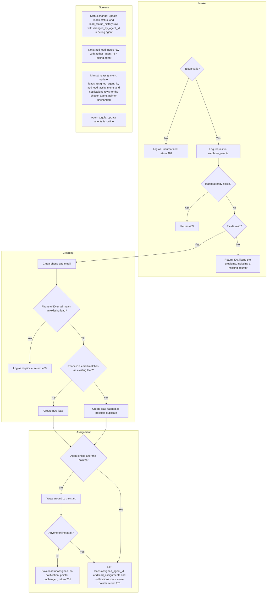
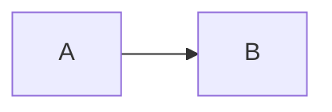
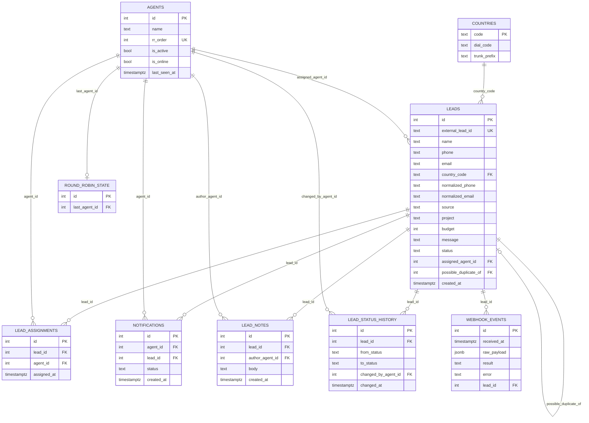

# Lead App

A lead intake and management tool for a take-home assessment. It has a React front end, and Supabase provides the database, the round-robin assignment logic, and the incoming-lead endpoint.

## Overview

The app receives leads from an external source through `POST /functions/v1/leads-incoming`. Each lead is checked, cleaned, checked for duplicates, saved, and assigned to an agent in round-robin order, using only online, active agents. An agent can also be picked by hand on a lead's detail page. Staff then work the leads: the Leads screen lists them, the detail screen changes status, assigns, and adds notes, and the Agents screen switches each agent online or offline. The process flowchart is under [Process flow](#process-flow).

### Process flow

#### Overall flow



#### Render test



## Setup

1. **Install the app's dependencies.**

   ```bash
   npm install
   ```

2. **Create a Supabase project.** Note its project URL and anon key.

3. **Create the database.** In the Supabase SQL Editor, run these in order on a new project:
   1. [schema.sql](schema.sql): the tables, the `countries` and `agents` seed rows, `round_robin_state`, `assign_next_agent`, and `create_lead_and_assign`.
   2. [assign_lead_manually.sql](assign_lead_manually.sql)
   3. [seed.sql](seed.sql), once only. A second run fails on duplicate `external_lead_id` values.

4. **Set the row-level security policies** that the app needs for the anon key. See [Security](#security) below, and check them with the query given there.

5. **Create `.env.local`** in the project folder:

   ```bash
   VITE_SUPABASE_URL=https://<your-project-ref>.supabase.co
   VITE_SUPABASE_ANON_KEY=<your-anon-key>
   ```

   This file is git-ignored. Do not put the service role key in it.

6. **Deploy the incoming endpoint.** Install the Supabase CLI, then run:

   ```bash
   supabase link --project-ref <your-project-ref>
   supabase functions deploy leads-incoming --no-verify-jwt
   supabase secrets set INCOMING_LEAD_TOKEN=<a-long-random-token>
   ```

   The token is the value senders must put in the `Authorization` header. Choose it yourself, and keep it out of the repository.

7. **Start the app:**

   ```bash
   npm run dev
   ```

   Then open `http://localhost:5173/`.

## Database schema

### Tables

| Table | Purpose |
|---|---|
| `countries` | Dial code and trunk prefix for each country (MY and SG), used to clean phone numbers. |
| `agents` | The four agents. `rr_order` sets the round-robin order. `is_online` and `is_active` decide who is eligible. |
| `round_robin_state` | One row holding `last_agent_id`, the agent who got the most recent automatic assignment. |
| `leads` | One row per lead. Holds contact details, the cleaned phone and email, the status, the assigned agent, and `possible_duplicate_of`. |
| `lead_assignments` | History of every assignment, automatic or manual, in order. |
| `notifications` | One row each time an agent is assigned a lead. |
| `lead_notes` | Notes on a lead, with the author's agent ID. |
| `lead_status_history` | Each status change, with the previous and new status and who made it. |
| `webhook_events` | The raw payload of every request to the incoming endpoint, with its outcome. |

### Entity relationship diagram



### Functions

- **`assign_next_agent()`** picks the next eligible agent. It locks the `round_robin_state` row, takes the first eligible agent after `last_agent_id`, wraps around to the start of the order if none is left, saves the pick, and returns it. If no agent is eligible, it returns null and leaves the pointer alone.
- **`create_lead_and_assign(...)`** inserts a lead, calls `assign_next_agent()`, and if an agent was picked, records the assignment and a notification. Both happen in one transaction.
- **`assign_lead_manually(lead_id, agent_id)`** sets the lead's agent, writes an assignment row, and writes a notification. It does not read or change `round_robin_state`.

## Round-robin and presence

### How the round-robin works

Every agent has a fixed position in `rr_order`: Amy 1, Ben 2, Chloe 3, Daniel 4. The `round_robin_state` row remembers who got the last automatic lead.

When a new lead arrives, `assign_next_agent()` looks for the next agent in order after the last one who is active and online. If there is none, it starts again from the first eligible agent. So with Amy, Ben, and Chloe online, leads go Amy, Ben, Chloe, Amy, and so on.

The function locks the state row while it works, so two leads arriving at the same moment cannot both pick the same agent.

### How presence works

Presence is one column: `agents.is_online`. The Agents screen toggles it. The round-robin skips any agent who is offline, and when that agent comes back, they rejoin at their own position in the order. The pointer does not reset.

Two things to know:

- `is_active` is a separate flag. An inactive agent is never picked, whether online or not. The app does not yet have a screen to change it.
- `last_seen_at` exists but nothing writes to it. The app does not check for heartbeats; presence is whatever the toggle says.

### Manual assignment

A manual assignment from the detail page calls `assign_lead_manually`. It sticks to the chosen agent and leaves the round-robin pointer where it was. The next automatic lead goes to whoever comes next in the order, as if the manual pick had not happened.

## Endpoint: incoming leads

### POST /functions/v1/leads-incoming

**Headers**

| Header | Value |
|---|---|
| `Authorization` | `Bearer <INCOMING_LEAD_TOKEN>` (the token set as a function secret) |
| `Content-Type` | `application/json` |

**Request fields**

| Field | Required | Notes |
|---|---|---|
| `leadId` | Yes | Text. Must be unique: a repeated `leadId` returns 409. |
| `name` | Yes | Text. |
| `countryCode` | Yes | `MY` or `SG`. Anything else returns 400. |
| `phone` | One of `phone` or `email` | Cleaned to international form, e.g. `012-345 6789` (MY) becomes `+60123456789`. |
| `email` | One of `phone` or `email` | Must contain `@`. Stored in lower case. |
| `createdAt` | Yes | ISO date-time. Checked but not stored; the database sets `created_at`. |
| `source` | No | Text. |
| `project` | No | Text. |
| `budget` | No | Whole number, 0 or more. |
| `message` | No | Text. |

**Response codes**

| Code | Meaning |
|---|---|
| 201 | Lead created and assigned. The body gives `leadId`, `externalLeadId`, `assignedAgentId`, and `possibleDuplicateOf`. |
| 400 | Invalid payload. The body lists the problems. |
| 401 | Missing or wrong token. No lead is created. |
| 409 | Duplicate. Either the `leadId` was already received, or the phone and email both match an existing lead. The body gives the existing lead's ID. |

The endpoint also returns 405 for a request that is not POST, and 500 if the server fails.

## Assumptions and decisions

The full list, one line per decision with its reason, is in [DECISIONS.md](DECISIONS.md). The main ones are:

- **No login.** Staff pick an agent in an "Acting as" dropdown, and that agent is recorded on each status change and note. This is a stand-in for real authentication.
- **Anyone with the anon key can read and change the data.** This is a known gap, acceptable for a take-home and not safe for production. See [Security](#security).
- **Round-robin only for automatic assignment.** A manual assignment never moves the pointer.
- **Statuses** are `new`, `contacted`, `qualified`, `won`, and `lost`. The brief does not list statuses, so these were chosen.
- **Duplicates** are decided by the cleaned phone and email. If both match one existing lead, no new lead is created. If only one matches, the lead is created, assigned, and linked to the earlier lead.
- **Phone numbers** are stored as `+` followed by digits. A number starting with `+` or `00` already has its country code. Any other number has its trunk prefix (MY: `0`) removed and the country code added. Limitation: a number that includes its country code but has no `+` or `00` gets the code added twice. For example, `6591234567` for SG becomes `+656591234567`. Senders should use `+6591234567`, or the local form `91234567`.
- **Two writes are not atomic.** A status change writes the lead and then its history row. An incoming lead is created and then has its cleaned fields saved. If the second write fails, the first is kept.

## Security

The app talks to Supabase with the anon key, so the row-level security policies decide what it can do. The policies the app needs are:

| Table | Operation | Why |
|---|---|---|
| `leads` | select, update | List leads, change status, and assign. |
| `agents` | select, update | Dropdowns, and the online/offline toggle. |
| `lead_notes` | select, insert | Show and add notes. |
| `lead_status_history` | insert, select | Record and show status changes. |
| `lead_assignments` | select | Added for the test script, to read assignment rows. Can be removed after testing. |
| `notifications` | select | Added for the test script, to read notification rows. Can be removed after testing. |
| `webhook_events` | select | Added for the test script, to read the event log. Can be removed after testing. |

The incoming endpoint uses the service role key that Supabase provides to the function, so it does not need anon policies.

To check the policies in your own database, run this in the SQL Editor and compare the result with the table above:

```sql
select tablename, policyname, cmd, roles
from pg_policies
where schemaname = 'public'
order by tablename, cmd;
```

**Known gap:** these policies let anyone with the anon key read and change the data. This is accepted for the take-home, which has no login. Real use needs authentication and per-agent policies.

## Limitations

- **Open anon policies.** The policies in [Security](#security) let anyone with the anon key read and change leads, agents, notes, and status history. The three read policies added for the test script also expose assignments, notifications, and the webhook log. There is no login to limit this. Fixing it needs real authentication and per-agent policies.
- **Singapore numbers without `+` or `00`.** A SG number that already includes the country code, such as `6591234567`, has `65` added a second time and is stored as `+656591234567`. Senders must use `+6591234567` or the local form `91234567`. The endpoint does not detect this, so a bad number is saved without an error.
- **Presence has no heartbeat.** An agent is online only until someone toggles them off. If an agent closes the app or leaves their desk while online, the round-robin keeps assigning them leads. `agents.last_seen_at` exists but nothing writes to it.
- **Country code is not checked against the phone number.** `countryCode` is used only to choose how to clean a number without `+` or `00`. A number that starts with `+` is kept as it is, even when it belongs to the other country. For example, `countryCode: "MY"` with `+6591234567` is stored as `+6591234567` with `country_code` set to `MY`. Duplicate matching still works, but the country field can be wrong.

## Bonus items

The brief lists these as optional. The ones built or partly built are below.

- **Data validation (built).** The endpoint checks required fields, country code, email format, ISO date, and budget. Phone numbers are cleaned and must be 8 to 15 digits. `phone_test.ts` covers six phone inputs.
- **Security (partly built).** Requests need a bearer token, compared in constant time. The body of an unauthorized request is not stored. There is no login, and the anon-key policies let anyone read and change the data (see [Limitations](#limitations)).
- **Agent presence tracking (partly built).** Agents switch online or offline on the Agents screen, and round-robin skips offline agents. There is no heartbeat, and `last_seen_at` is never written (see [Limitations](#limitations)).
- **Notifications (partly built).** Each assignment, automatic or manual, writes a `notifications` row. Nothing delivers the notification or shows it in the app.
- **Audit logging (partly built).** Every request to the endpoint is logged in `webhook_events`. Assignments, status changes, and notes are recorded with their times, and status changes and notes also record the acting agent. Agent online and offline changes are not logged.

## Not built and why

- **Retry handling.** Failed writes are logged with their error, but nothing retries them. The sender must send the request again. A resend is safe for a lead already saved, because the 409 response stops a second copy.
- **Dashboards.** The Leads and Agents screens cover the brief. Totals and charts were not needed to show the lead flow.
- **Search.** The lead list is short and sorted by newest, so a search box was not needed for the test data.
- **Real-time communication.** Screens load data when they open or after a change, so a second person's change appears on refresh. Live updates would need Supabase subscriptions.
- **Workload visibility.** The lead list does not show how many leads each agent holds, and no count was added.
- **Caching.** Reads are small and go straight to the database. No cache layer was added, so nothing can show stale data.
- **Queue-based processing.** The endpoint writes each lead straight to the database. Expected volume is low, so a queue would add parts to run without a clear gain.
- **Assistant-style operational features.** Nothing in the brief needed them, and none were added.

## Test logs

### Round-robin function (Step 3), 1 Nov 2026

Tests run manually by me.

The first attempt at the pick query failed, because it called `assign_next_agent()` once per agent row. The query was changed to call the function once. The results below are from the corrected query.

| # | Action | Expected | Observed |
|---|---|---|---|
| 1 | Starting state: Amy, Ben, Chloe online; Daniel offline; pointer null. Pick | Amy | Amy |
| 2 | Pick | Ben | Ben |
| 3 | Set Ben offline, then pick | Chloe (Ben skipped) | Chloe |
| 4 | Pick | Amy (wrap-around) | Amy |
| 5 | Pick | Chloe | Chloe |
| 6 | Set Ben online, then pick | Amy (wrap-around) | Amy |
| 7 | Pick | Ben | Ben |
| 8 | Set Daniel online, then pick | Chloe | Chloe |
| 9 | Pick | Daniel | Daniel |
| 10 | Pick | Amy (wrap-around) | Amy |
| 11 | Set all agents offline, then pick | null | null |
| 12 | Read `round_robin_state.last_agent_id` | 1 (Amy) | 1 |
| 13 | Set Amy online, then pick | Amy | Amy |

### Lead detail screen (Step 5), 1 Nov 2026

Tests run manually by me, except row 4, which was checked in the browser pane. Each change was checked after a page refresh.

| # | Action | Expected | Observed |
|---|---|---|---|
| 1 | Change a lead's status from contacted to qualified, acting as Ben | Status shows as qualified after refresh. A history row records the change, changed by agent 2. | Matched |
| 2 | Add the note "Called. Interested in a viewing." acting as Ben | The note is saved with author 2 and shows on the lead after refresh. | Matched |
| 3 | Assign Kevin Ng from Chloe to Ben | The detail page and the list show Ben. `lead_assignments` has a row for Ben after Chloe. | Matched. The notification row and the round-robin pointer were not reported. |
| 4 | Click a lead name, then "Back to leads" | The list reloads and shows the current agent. | Matched (checked in the browser pane) |
| 5 | Seed five leads with Amy, Ben, and Chloe online and the pointer on Amy | Ben, Chloe, Amy, Ben, Chloe | Matched |

Two problems found during this testing are described in [DECISIONS.md](DECISIONS.md).

### Agent status screen (Step 6), 1 Nov 2026

Tests run manually by me on 1 Nov 2026.

Starting state: Amy, Ben, and Chloe online; Daniel offline; round-robin pointer on Chloe.

| # | Action | Expected pick | Actual |
|---|---|---|---|
| 1 | Set Ben offline on the Agents screen, then pick | Amy | Matched |
| 2 | Pick again | Chloe (Ben skipped) | Matched |
| 3 | Pick again | Amy (wrap-around) | Matched |
| 4 | Set Ben online on the Agents screen, then pick | Ben | Matched |

## Test log: incoming endpoint

Tests run manually by me on 1 Nov 2026.

| # | Action | Expected | Observed |
|---|---|---|---|
| 1 | Valid lead with correct token (`LD2001`) | 201. Lead created and assigned. | 201. Lead 11 created and assigned to Amy. Normalised phone `+60123456789`. One assignment row, one notification row, webhook logged as accepted. |
| 2 | Same phone and email as case 1, new `leadId` (`LD2002`) | 409 with the existing lead's ID. No new lead. Logged as duplicate. | 409. Matched lead 11. No new lead. Logged as duplicate. |
| 3 | Missing `countryCode` (`LD2003`) | 400. No lead. Logged as invalid. | 400. No lead. Logged as invalid. |
| 4 | Wrong token (`LD2004`) | 401. No lead. Logged as unauthorized. | 401. No lead. Logged as unauthorized. |

Lead 11 (`LD2001`) is the test lead from case 1. It was left in the database as a record of the test.
